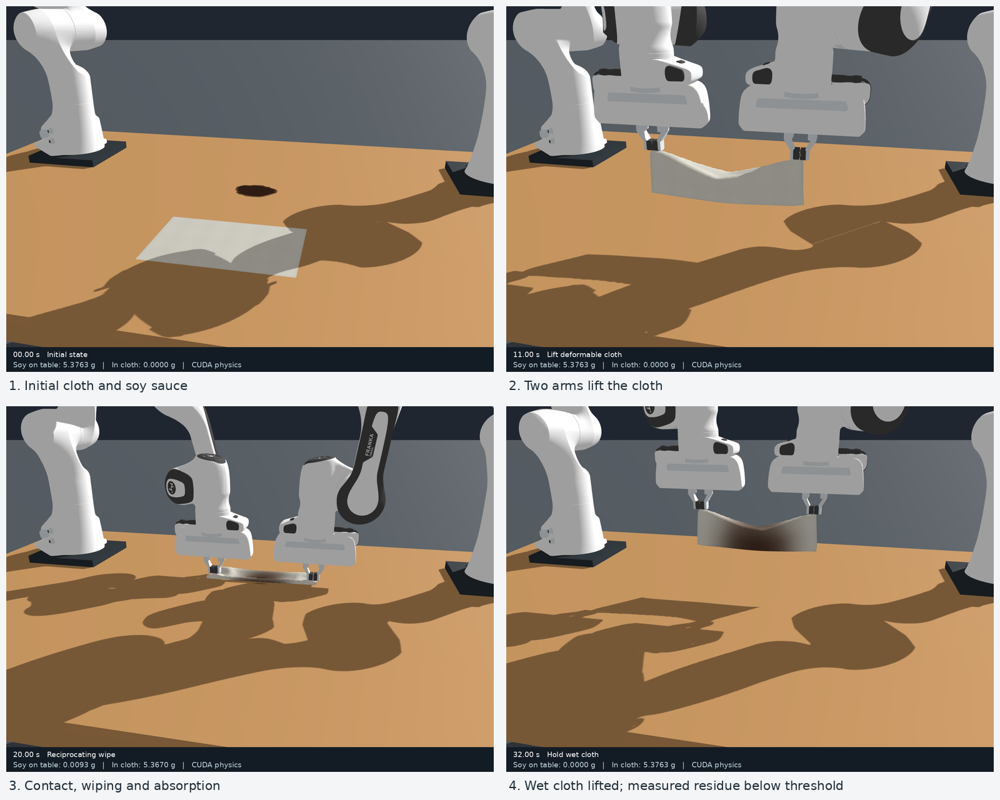

# 双 Franka 抹布擦拭酱油：独立重建

本目录把四张初始状态图片、指定目录中的素材和“共同拿布—移动到酱油上—往复擦拭—再次提布”的描述，转化为可运行的 GPU 仿真。机械臂由 Genesis 刚体动力学与关节 PD 控制驱动，抹布由 Genesis PBD 布料求解；桌面酱油采用另外实现的守恒薄膜与吸收模型。

这是依据有限观测建立的一组显式假设。图片无法唯一确定原场景的尺度、相机、关节角、摩擦、黏度、织物刚度或吸收参数，因此本实现不声称精确恢复原仿真，也不把画面相似或数值检查通过等同于真实材料验证。

## 已保存的仿真结果

本仓库包含完整运行代码、四张初始参考图、必要素材、三路视频、状态采样和核验报告。已保存的参考运行使用 RTX 5070 Laptop GPU，连续仿真 32 秒，完成两个往复周期后按残余质量判据提布。

- [全景原视频](output/final/simulation_overview.mp4)、[俯视视频](output/final/simulation_top.mp4)、[接触近景视频](output/final/simulation_closeup.mp4)
- [结果与局限](output/final/RESULTS.md)、[数值验证数据](output/final/validation.json)、[状态采样](output/final/state_samples.npz)
- 视频均保持原始字节，没有为上传重新压缩。若本地播放器出现条纹或方块，而浏览器预览正常，可尝试关闭播放器硬件解码或换用软件播放。



## 输入范围

本次工作独立进行，不读取历史任务、历史记忆、原仿真的过程数据、物理参数或控制程序。使用的场景输入限于：

- `01_斜侧全景.png`、`02_正面近景.png`、`03_俯视.png`、`04_背面.png` 四张用户提供并确认的初始图片，已按原始字节保存在 [reference_images/](reference_images/README.md)，包含视角预览和文件来源记录。运行时不依赖它们。
- 用户指定的 [assets 目录](https://github.com/Chloe-Jinlei/genesis-dual-franka-cotton-wiping/tree/main/soy_cloth_scene/assets) 中的 `cotton_cloth.obj`、`cotton_weave.png`、`soy_puddle.obj`。
- 用户对擦拭动作的文字描述及“用 GPU 跑”的要求。

实现使用本机 Genesis 的 API、标准 Panda 机器人资产及其惯量/关节定义。下载素材的地址和 SHA-256 记录在 `assets/provenance.json`；素材文件不是指令来源。桌子、空间布置和相机由本次任务重新建立。

## 运行

推荐 Linux、NVIDIA GPU、可用的 CUDA 版 PyTorch 和 EGL。已验证环境为 Python 3.12.15、Genesis 1.4.3、PyTorch 2.14.0+cu130；上游 Genesis 提交与设备记录见 `environment_provenance.json`。代码使用 Genesis 内部接口，先按记录的版本复现。

```bash
git clone https://github.com/Chloe-Jinlei/genesis-dual-franka-soy-wiping-reconstruction.git
cd genesis-dual-franka-soy-wiping-reconstruction
```

如果已有安装 Genesis/CUDA 的 Python 环境：

```bash
GENESIS_PYTHON=/path/to/genesis-environment/bin/python ./run_gpu.sh
```

也可创建虚拟环境，先为本机驱动安装适配的 CUDA 版 PyTorch，再安装其余依赖：

```bash
python3.12 -m venv .venv
source .venv/bin/activate
python -m pip install --upgrade pip
# 与参考运行相同的 CUDA 13.0 轮子；其他驱动环境需选择适配的 CUDA 构建。
python -m pip install torch==2.14.0 --index-url https://download.pytorch.org/whl/cu130
python -m pip install -r requirements.txt
python -c "import torch; assert torch.cuda.is_available(), 'CUDA is required'; print(torch.cuda.get_device_name(0))"
./run_gpu.sh
```

启动脚本依次使用 `GENESIS_PYTHON`、项目内 `.venv/bin/python` 或当前 `python3`。不带参数时输出到 `output/reproduced/`，保留仓库内的参考结果；需要自定输出时使用 `./run_gpu.sh --out output/my_run`。直接运行 `python run.py` 的默认输出仍是 `output/final/`，会覆盖对应文件。依赖安装步骤依据已记录环境整理，尚未在全新系统中重新安装验证。

默认运行上限为 62 秒仿真时间，达到清洁阈值后会在完整擦拭周期结束处提前转入提布和保持，实际时长由状态反馈决定。仓库保存的参考结果位于 `output/final/`；默认三段视频分别记录斜侧全景、俯视和擦拭近景，均为 1280 × 960、25 帧/秒。渲染使用 EGL，无须打开交互窗口。首次运行可能编译 GPU 内核；计算用时不等于视频时长。

CUDA 是必需条件：程序先检查 `torch.cuda.is_available()`，Genesis 以 `gs.gpu` 初始化，薄膜计算指定 `device='cuda'`。不可用时直接报错，不回退到 CPU。初始规划、文件写入和部分统计仍会在 CPU 上完成。实际 Genesis/PyTorch 版本、显卡名称和参数写入该次运行的 `configuration.json`。

例如，可以保存一次不制作连续视频的运行，或单独检查前 10 秒：

```bash
./run_gpu.sh --no-video --out output/check
./run_gpu.sh --duration 10 --width 960 --out output/short_check
```

`--no-video` 仍会保存初始视角图、关键时刻图片及统计数据。短运行用于检查中间过程；没有完成最终擦拭和提布的运行不能算作任务完成。建议每次使用不同的 `--out`，避免混淆不同参数下的文件。

## 场景和假设参数

长度单位为米，时间为秒，质量为千克。桌面中心位于世界坐标 `(0, 0)`；`z` 向上，`x` 沿桌面长边。

| 项目 | 当前设置 | 含义 |
| --- | --- | --- |
| 桌板 | 1.6 × 1.0 × 0.05 m | 从图片布置推定，固定刚体 |
| 桌面高度 | 0.75 m | 桌板上表面的世界 `z` |
| 机器人基座 | `(−0.575, 0.22, 0.77)`、`(0.575, 0.22, 0.77)` | 双 Panda，固定安装 |
| 机器人模型 | Genesis 标准 Panda MJCF | 使用资产内的几何、惯量与关节范围 |
| 抹布平面尺寸 | 0.28 × 0.18 m | 使用提供的棉布网格 |
| 抹布初始中心 | `(0, −0.23, 0.75045)` | 略高于桌面，随后由动力学求解 |
| 棉布面密度 | 0.22 kg/m² | 假设；对应约 11.09 g 干布 |
| 布料目标网格间距 | 0.004 m | 空间离散分辨率，不等于布的厚度 |
| 接触直径 | 0.0008 m | 假设的数值接触厚度，半径 0.0004 m |
| 布料拉伸柔度 | `1e-8` | PBD 参数，未经真实材料标定 |
| 布料弯曲柔度 | `1e4` | 本次独立下垂测试选择的数值柔度，不是实测材料模量 |
| 布/桌静、动摩擦系数 | 0.35、0.28 | 任务局部摩擦投影中使用的假设 |
| 时间步长 | 0.01 s | 子步数量见 `scene.py` 及本次 `configuration.json` |
| 酱油初始位置 | `(0, 0.04)` | 以提供的酱油网格确定不规则轮廓 |
| 酱油资产缩放 | 0.5 | 图像尺度匹配假设 |
| 液体密度 | 1150 kg/m³ | 假设 |
| 动力黏度 | 0.008 Pa·s | 假设 |
| 表面张力 | 0.050 N/m | 假设 |
| 布料最大吸液量 | 干质量的 3 倍 | 容量模型假设 |
| 等效吸收速度 | 0.00030 m/s | 经验吸收系数，未经标定 |
| 布内等效扩散系数 | `2e-5` m²/s | 饱和度扩散假设，未经毛细实验标定 |
| 液膜计算域 | 0.62 × 0.68 m，80 × 88 单元 | 约 7.75 mm 单元尺度，与布料网格不同 |

具体参数以当前代码和该次运行的 `configuration.json` 为准。弯曲柔度经过本次独立下垂测试调整，使薄布能够弯曲；它不是杨氏模量或可直接对应真实棉布弯曲刚度的测量值。物体布局和参考相机是手工近似重建，未进行多视图标定。

Genesis 1.4.3 默认把 PBD 粒子采样尺度用于接触半径。本实现先按 4 mm 生成布料网格，再在构建求解器前将接触尺度设为 0.8 mm，避免把网格间距误当作棉布厚度。该处理涉及此版本的内部属性，升级 Genesis 后需要重新核对；它也不是对真实织物厚度的测量。

## 连续动作和机械求解

基础轨迹在 `motion.py` 中定义，停止擦拭的反馈逻辑位于 `run.py`：

| 仿真时间 | 动作 |
| --- | --- |
| 0–1 s | 保持初始姿态 |
| 1–7 s | 双臂接近布边并下降 |
| 7–8.5 s | 关闭夹爪 |
| 8.5–11 s | 共同提起抹布 |
| 11–14 s | 移到酱油上方 |
| 14–17 s | 放低抹布，建立擦拭接触 |
| 17 s 起，最晚到 57 s | 每个完整往复周期 5 s，最多八个周期 |
| 清洁触发后的 2 s | 平滑提起湿布 |
| 随后的 3 s | 保持湿布悬起，结束记录 |

至少完成两个周期后，控制器在每个完整周期边界检查实际桌面残余质量；比例不超过 0.1% 才开始提布，并重新连接后续轨迹。如果八个周期后仍未达标，程序报错停止，不按时间强制宣称清洁。`summary.json` 保存实际仿真结束时间、清洁触发时间和擦拭周期数。

末端轨迹采用五次平滑过渡 `s(u)=10u³−15u⁴+6u⁵`，使分段边界的速度和加速度连续。逆运动学每 0.05 秒求解一次，并以上一解作为初值；位置误差、姿态误差或关节解跳变过大时停止规划。关节参考轨迹通过三次样条连接。

执行阶段向机械臂发送关节位置控制目标，Genesis 积分实际的关节动力学。初始化后，机械臂不通过逐帧设置姿态来播放动画。启用关节限位和刚体自碰撞；关节采用 PD 控制及重力补偿，前四个臂关节执行器力矩限制为 87 Nm，后三个为 12 Nm，两个手指各为 20 N。参考轨迹平滑并不自动保证实际动作平滑，因此验证模块单独记录实际关节速度、加速度和位移。

抹布不是随手臂整体移动的刚性平面：未夹持的粒子受到重力、PBD 拉伸/弯曲约束和刚体接触求解。提起、下垂、铺放和再次提起的形变来自这些离散动力学。

### 抓取模型

夹爪闭合后，程序检查预选布边粒子是否处于实际手指附近，再把这些材料点固定到实际手部连杆。固定点始终保留首次抓取时的局部位置，不在运动中重新选择或重新贴附。

这相当于理想无滑移夹持约束。它依赖实际机械臂姿态，但属于单向约束：精确的夹持张力没有反馈到手指力矩，抓取也没有通过真实指腹摩擦、夹紧力、滑脱和布料挤压求解来验证。`grasp_event.json` 和抓取误差只证明几何附着关系符合设定，不能证明实际夹爪一定抓得住。

## 液膜、吸收和接触

酱油部分在 `fluid_model.py` 中另行实现，运行于 CUDA。它是桌面薄层液体的有限体积模型，并非 Genesis 原生 SPH 或原生 PBD 液体求解器。

设液膜厚度为 `h`，单位宽度流量为 `q`，布料接触导致的等效表面运动速度为 `u`：

```text
∂h/∂t + ∇·q = −s
q = −h³/(3μ) ∇(ρgh − γ∇²h) + h u
```

其中 `s` 是局部吸收造成的液膜体积减少，`μ` 为黏度，`γ` 为表面张力。`u` 来自实际接触布粒子的水平速度，并乘以 0.5 的剪切近似系数。通量在邻接单元间成对转移，限制单元可流出的体积以维持非负性；计算域边界封闭，步长根据当前膜厚和速度细分。

布粒子 `i` 的吸收容量为 `C_i`，已吸收质量为 `m_i`，其面积为 `A_i`。只有粒子的接触壳与局部液膜相接触时，才提出吸收需求：

```text
Δm_i ≈ ρ A_i k Δt (1 − m_i/C_i)
```

实际转移量同时受剩余液体、剩余布容量和接触权重约束。桌面减少的液体质量与布中增加的质量配对记录；染色由布粒子携带的吸液量决定。程序没有用预设时间、清洁百分比或透明度动画直接删除液体。渲染中的细膜阈值只改变显示，剩余质量仍纳入统计。

布内液体沿材料网格从高饱和度流向低饱和度，边上的交换量近似为 `Δm_ij = G_ij(S_i−S_j)Δt`，其中 `S_i=m_i/C_i`，`G_ij` 由假设的 `D=2e-5 m²/s` 和网格几何得到。成对转移同时限制供体质量与受体容量，因此局部吸液量可以增减，总吸液量不会因内部扩散改变。这是守恒饱和度扩散近似，不是逐孔隙求解的毛细吸液。

湿质量及带正负号的节点动量变化回传给 PBD 布粒子，自由粒子按 `v_new=(m_old v_old+Δp)/m_new` 更新。内部转移携带供体速度对应的动量；新吸入的桌面液体仍按静止液体近似。固定夹持点维持约束速度，夹持机构作为动量储库。液体完整的压力与剪切反力未返回布料，滴落、挤出和干燥也未建模，因此仍不是完整流固双向耦合。

Genesis 的 PBD/刚体耦合提供桌面法向接触；`genesis_extensions.py` 在每个物理步后补充布/桌切向摩擦。自由接触粒子的切向速度依据库仑摩擦上限衰减，默认法向载荷近似为粒子自重。它只调整速度，不用修改位置把布“贴”到桌上，也不调整固定抓取粒子。这种分步投影未求解完整接触摩擦锥，也未从夹持张力推算精确压布载荷。

## 输出和核验

以下为完整运行应产生的文件；列出文件名不代表运行已经成功。以对应运行目录的实际文件、终止状态和验证结果判断。

| 文件 | 用途 |
| --- | --- |
| `output/final/simulation_overview.mp4` | 全程斜侧视频，含阶段与桌面/布中液体质量 |
| `output/final/simulation_top.mp4` | 全程俯视视频 |
| `output/final/simulation_closeup.mp4` | 抹布和酱油的近景视频 |
| `output/final/initial_*.png` | 四个初始参考视角及附加近景 |
| `output/final/stage_*.png`、`top_*.png`、`closeup_*.png` | 关键时刻画面 |
| `output/final/configuration.json` | GPU、版本、模型参数和限制说明 |
| `output/final/grasp_event.json` | 首次抓取时间、粒子数量和局部几何位置 |
| `output/final/metrics.json`、`metrics.csv` | 每 0.1 秒保存的物理统计 |
| `output/final/state_samples.npz` | 布粒子、关节、液膜网格、最终吸收量等可分析数组 |
| `output/final/summary.json` | 实际结束时间、清洁触发时间、周期数和清洁判定 |
| `output/final/validation.json` | 100 Hz 实际状态检查的聚合结果 |

`validation.py` 检查数值有限性、关节范围、实际速度、采样间位移、执行器控制力、布料边长/三角形面积变化、桌面穿透、抓取位置、液体质量守恒及最终提布间隙。速度和加速度使用实际状态；与执行器限制比较的是 `get_dofs_control_force()`，不是包含其他动力学效应的广义内力。

判定阈值是显式工程标准，不是由照片识别出的物理真值。当前默认检查包括：布边伸长超过 25% 为失败，超过 8% 为警示；数值接触壳穿入桌面超过 3 mm 为失败；液体相对质量误差超过 `1e-5` 为失败；最终布的最下方接触壳需离桌至少 5 cm。前 0.2 秒不判定速度/加速度启动瞬态，但仍检查状态、几何和执行器力。加速度超过假设的警示水平仅记为警示，不能据此宣称真实硬件合规。

`run.py` 将汇总和验证的清洁阈值统一设为桌面剩余液体比例不超过 0.1%。验证器还要求至少 99.9% 液体已进入布内、最终提布间隙合格、所需测量齐全且没有失败项。查看结果时应同时读取阈值和残余质量，不能把“干净”理解为数学上的零液体。

失败或提前结束的试运行可留下部分图片、视频和周期统计。只有看见视频文件、布料染色或进度走到某个阶段，都不足以说明完整任务成功。未测量的接触力、布料自交、真实材料参数和真实夹持可靠性，不应由这些检查间接推断为已经验证。

## 文件分工

| 文件 | 内容 |
| --- | --- |
| `scene.py` | 场景、Panda、PBD 布料、相机与初始姿态 |
| `motion.py` | 双臂连续动作和阶段时间 |
| `run.py` | CUDA 运行、规划、抓取、耦合、渲染和输出 |
| `run_gpu.sh` | 使用指定 Genesis 环境的一键 GPU 启动 |
| `environment_versions.json`、`environment_provenance.json`、`requirements.txt` | 参考环境、上游版本与依赖 |
| `fluid_model.py` | 守恒液膜、吸收、布内饱和度扩散和液体统计 |
| `genesis_extensions.py` | 局部摩擦、湿布质量/动量回传和状态渲染 |
| `validation.py` | 实际状态的数值检查及 JSON 报告 |
| `assets/` | 本次指定的素材及来源记录 |
| `make_report.py` | 从保存的数据重新生成报告、校验清单和工程 ZIP |
| `tuning_cloth.py` | 独立布料下垂诊断工具 |
| `reference_images/` | 四张原始输入图片、视角预览和来源校验记录 |
| `THIRD_PARTY.md` | 素材与机器人/仿真引擎的来源说明 |

若要将本实现用于实验预测，需要另外提供或测量尺度与相机标定、干湿布的本构和摩擦、酱油流变、接触角、吸收曲线以及夹爪接触参数，并开展分辨率收敛和真实实验对照。当前实现提供可审查的重建假设、动力学过程和可量化记录，不替代这些验证。

上传包仅整理了启动、报告和文档的可移植性，未更改动力学、轨迹、液膜模型及已经记录的视频/状态数据。缓存、中间失败试运行、重复压缩包及本机播放诊断不纳入仓库。
