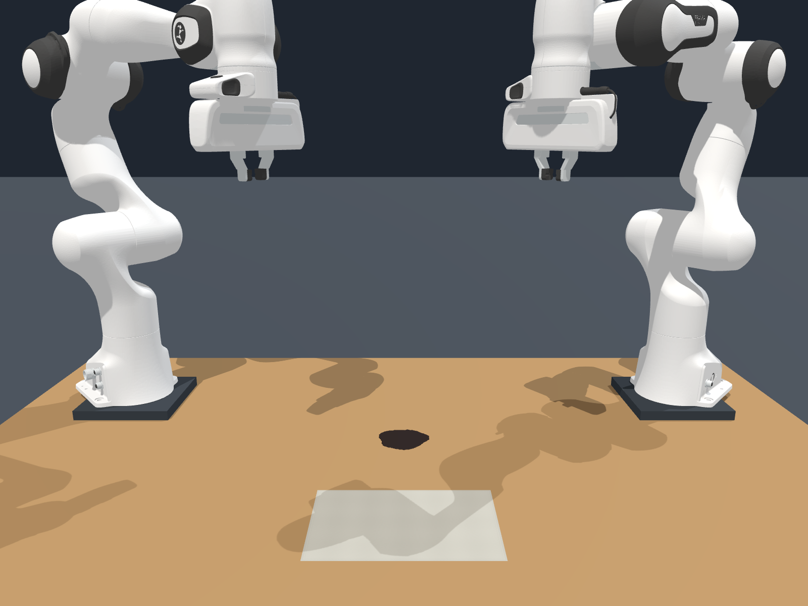
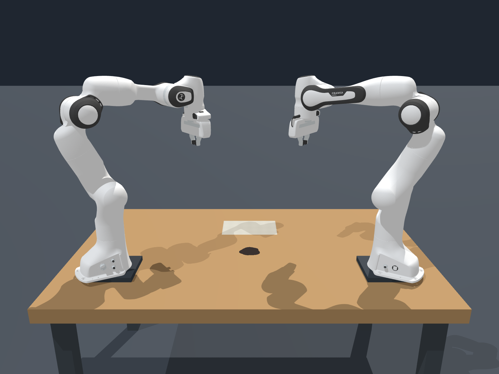

# 四个视角的初始参考图

这四张图由用户提供并确认，是同一仿真初始状态的不同视角。图片按原始字节保存，仅按视角命名，没有修改内容、缩放或重新压缩。原始文件名和 SHA-256 见 [provenance.json](provenance.json)。

| 斜侧全景 | 正面近景 |
| --- | --- |
|  |  |

| 俯视 | 背面 |
| --- | --- |
|  |  |

这些图片用于推定初始布局；仿真运行时不读取它们。运行所需的网格、纹理和参数均包含在仓库中。`output/final/initial_*.png` 是本实现重新渲染的结果，本目录保存的是用户输入的参考图。
